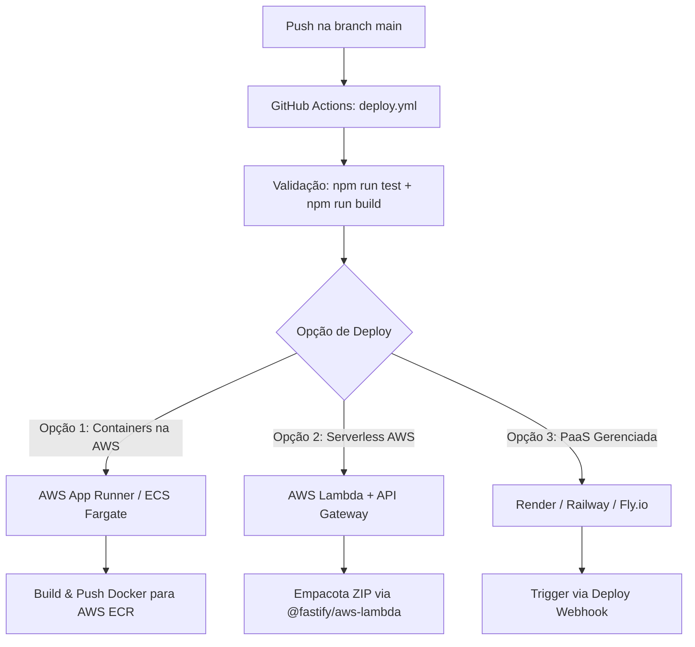

# 🚀 Plano de Deploy para o Backend (BackendCodeHub)

Este documento descreve a estratégia e as alternativas de arquitetura para a automação do deploy da API **BackendCodeHub** via GitHub Actions.

---

## 📌 Contexto & Diagnóstico

### Por que o deploy do Frontend (S3 + CloudFront) não serve para o Backend?
O workflow herdado do frontend enviava arquivos HTML/JS/CSS estáticos gerados pelo Angular (`dist/.../browser`) para um bucket **AWS S3** e invalidava o cache do **CloudFront** (CDN).

Diferente de um SPA (Single Page Application), a API **BackendCodeHub**:
- É uma aplicação Node.js desenvolvida com **Fastify** e **TypeScript**.
- Exige um processo em execução contínua escutando portas de rede (ex: porta `3000`).
- Processa requisições HTTP dinâmicas, valida tokens OAuth2 e interage com APIs externas (Google Tasks).
- Necessita de um runtime de servidor contínuo (contêiner/VM) ou um ambiente de execução Serverless.

---

## 🗺️ Visão Geral das Estratégias



---

## 🏗️ Opções de Implementação

### Opção 1: AWS App Runner ou AWS ECS Fargate *(Recomendado para manter ecossistema AWS)*

Como você já possui credenciais AWS configuradas no GitHub (`AWS_ACCESS_KEY_ID`, `AWS_SECRET_ACCESS_KEY`), esta é a abordagem mais alinhada à sua infraestrutura atual.

#### 1. Criação do `Dockerfile` (Multi-stage build)
```dockerfile
# Estágio de compilação
FROM node:22-alpine AS builder
WORKDIR /app
COPY package*.json tsconfig.json ./
RUN npm ci
COPY src ./src
RUN npm run build

# Estágio de execução
FROM node:22-alpine AS runner
WORKDIR /app
ENV NODE_ENV=production
COPY package*.json ./
RUN npm ci --omit=dev
COPY --from=builder /app/dist ./dist

EXPOSE 3000
CMD ["npm", "start"]
```

#### 2. Fluxo do `deploy.yml` para AWS Containers
1. **Testes & Build**:
   - `npm ci`
   - `npm run test -- --ci`
   - `npm run build`
2. **Autenticação AWS**:
   - `aws-actions/configure-aws-credentials`
3. **Build e Push da Imagem**:
   - `aws-actions/amazon-ecr-login`
   - `docker build -t $ECR_REGISTRY/$ECR_REPOSITORY:$IMAGE_TAG .`
   - `docker push $ECR_REGISTRY/$ECR_REPOSITORY:$IMAGE_TAG`
4. **Deploy**:
   - Atualizar serviço no **AWS App Runner** ou atualizar Task Definition no **ECS Fargate**.

---

### Opção 2: AWS Lambda + API Gateway (Serverless)

Indicado para custo praticamente zero em ambientes de desenvolvimento ou tráfego esporádico.

#### 1. Dependência necessária:
```bash
npm install @fastify/aws-lambda
```

#### 2. Adaptação no entrypoint:
Exportar o handler do Fastify encapsulado pelo `@fastify/aws-lambda` para que o AWS Lambda consiga responder às requisições do API Gateway.

#### 3. Fluxo do `deploy.yml`:
1. `npm ci && npm run build`
2. `npm ci --omit=dev`
3. Gerar arquivo `.zip` contendo `dist/` e `node_modules/`
4. `aws lambda update-function-code --function-name backendcodehub-api --zip-file fileb://build.zip`

---

### Opção 3: PaaS Gerenciada (Render, Railway, Fly.io)

Abordagem mais rápida e simples, ideal caso não queira lidar com a complexidade de ECR/ECS da AWS.

#### 1. Configuração na Plataforma:
- **Build Command**: `npm ci && npm run build`
- **Start Command**: `npm start`
- **Porta**: `3000` (definir variável de ambiente `PORT=3000` ou ler `process.env.PORT`)

#### 2. Fluxo do `deploy.yml`:
O workflow no GitHub Actions apenas roda os testes para validar a `main` e dispara uma requisição `curl` para o **Deploy Hook** fornecido pelo painel do Render/Railway:
```yaml
- name: Trigger Deploy Webhook
  run: curl -X POST "${{ secrets.DEPLOY_HOOK_URL }}"
```

---

## 📋 Checklist de Pré-requisitos para Ativação do Deploy

1. [ ] Definir o provedor de hospedagem desejado (AWS App Runner/ECS, AWS Lambda ou PaaS como Render/Railway).
2. [ ] Configurar as variáveis e secrets no GitHub (`Settings -> Secrets and variables -> Actions`):
   - Se AWS: `AWS_ACCESS_KEY_ID`, `AWS_SECRET_ACCESS_KEY`, `AWS_REGION`, `ECR_REPOSITORY`, etc.
   - Se PaaS: `DEPLOY_HOOK_URL`.
3. [ ] Ajustar o `src/server.ts` para ler a porta da variável de ambiente `process.env.PORT || 3000` e escutar em `0.0.0.0` (necessário para contêineres Docker).
4. [ ] Substituir o conteúdo de `.github/workflows/deploy.yml` pelo workflow correspondente à opção escolhida.

